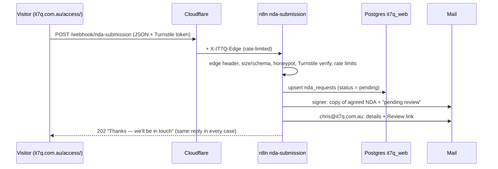

# IT7Q website rebuild — plan

Status: **plan only, nothing built yet.** Drafted 26 Oct 2026 for Chris to review.
Target: `it7q.com.au`, pure HTML/CSS/JS, no frameworks, Australian English.

---

## 0. Bottom line

- **Multi-page static site** replacing v2's single page. We reuse v2's look (navy/cyan/amber, Rajdhani + DM Sans), its copy and its layout ideas. We rebuild the structure, the forms and the NDA gate.
- **Division detail never ships in the static site.** Public pages hold a teaser and a thumbnail only. Full content lives server-side (Postgres, read by n8n) and only reaches the browser after an approved login. If anything goes wrong (n8n down, bad token, revoked, expired, odd response), the page stays locked.
- **No secrets in the site.** Webhooks are protected by server-side checks in n8n, plus bot protection, rate limits and a Cloudflare-injected edge header. The site itself holds nothing worth stealing.
- **Three new webhooks, not two.** Besides `nda-submission` and `nda-login`, I'm proposing `nda-content`, which serves gated content to a valid session, and `nda-review`, which handles Chris's approve/reject. See open question 1.
- Everything server-side (n8n workflows, SQL, Cloudflare settings) gets written as **files in this repo for Chris to review and deploy**. I don't touch n8n, Docker or Cloudflare.

---

## 1. What the source material says

| Source | Date | What it gives us | Status |
|---|---|---|---|
| `_source/v2/` (zip) | May 2026 | Single-page site: hero, mission, 7 division cards, products tabs, portfolio (4), automations, contact form, NDA modal, cookie banner. ~40 KB HTML, 27 KB CSS, 5 KB JS. | Best base for look and copy. NDA and forms are **mock only**: `console.log` and nothing sent. The NDA **unlocks on ticking the box**, which is a fail-open gate. |
| `IT7Q comprehensive website design v1.0.0.md` | Jan 2026 | Chat transcript. Multi-page static site: per-division pages, TEMPESTAS/FABRICUS "coming soon" teasers, about, contact, privacy and cookie policies, client portal login + dashboard, blog/social hub, portal user guide. Still has NEXUS (since replaced by OPUS). | Page structure and policy text are useful. The portal dashboard links straight to homelab services (jellyfin, n8n, portainer… `*.it7q.com.au`) and keeps JWTs in localStorage, so **we drop it**. |
| `IT7Q website redesign with proposal integration.md` | Feb 2026 | Chat transcript. Feature list: look like proposal.nubius.com.au, add orange, hero = animated logo + row of division logos, NDA popup with T&C tick → emailed copy → login issued **on approval**, blog, enquiries page (pick service + division), client portal login, admin portal login, Neo website showcase + form, downloads page, plain English, **home users first, small business second**. NEXUS → OPUS. | Requirements still apply. The WordPress pivot in that chat is **superseded** by this brief (static only). |

Facts carried over: ABN 43 922 878 001, Kallangur QLD 4503, 0411 753 366 / WhatsApp, `enquiries@it7q.com.au` (v2) and `info@it7q.com.au` (Jan spec). See Q18.

---

## 2. Site map and pages

Home users come first and small business second. Everything is in plain English.

```
/                         Home
/about/                   About + mission
/divisions/               All seven divisions (teaser cards)
/divisions/msp/           ┐
/divisions/opus/          │
/divisions/mentis/        │  Each page: public teaser + thumbnail,
/divisions/tempestas/     │  then a locked panel. Full detail loads only
/divisions/portus/        │  after an approved login (see §4).
/divisions/fabricus/      │
/divisions/domus/         ┘
/portfolio/               Client websites (p1–p4 + Burpengary Jets)
/services/                "How we can help": plain-English services + enquiry form (pick service & division)
/contact/                 Contact details, WhatsApp/Messenger, short form
/access/                  NDA: read the agreement, request access, log in, log out
/investors/               Investor & partner area: shell page, all content gated (presentations, financials)
/blog/                    Blog/social hub (static posts, links to socials/YouTube)
/blog/<slug>/             Individual posts
/downloads/               Recommended downloads (links + plain-English why)
/legal/privacy/           Privacy policy (Australian Privacy Principles)
/legal/cookies/           Cookie policy
/legal/terms/             Website terms
/legal/nda/               The current NDA text, public so people can read it before requesting access
/404.html
```

**Page-by-page notes**

- **Home**: hero with the animated IT7Q logo (Feb notes) and a row of the seven division logos underneath, linking to the teaser pages. Short mission line. A "how we help" strip (home users, then small business). Portfolio highlight. Investor/partner call to action pointing at `/access/`. Contact strip.
- **Division pages**: one template, seven copies. Public: name, Latin meaning, 2–3 sentence teaser, thumbnail, a "Request full access" button, and a "Already approved? Log in" link. No product names, pricing, specs, roadmaps or financials in public HTML (Q14).
- **Services**: the public, home-user-facing "what we can do for you" page. It's kept generic so it doesn't leak gated MSP detail (Q15). The enquiry form has a service selector and a division selector.
- **Portfolio**: cards in the order p1 True Colours, p2 Red Bird, p3 Pine Rivers RSL, p4 The Artist Apron, then Burpengary Jets. Each has a screenshot placeholder and its hosted link labelled p1–p4 (Q12). Plus a "want a site like this?" call to action. That's the Neo showcase idea from the Feb notes. Neo's evaluation workflow is parked.
- **Access**: request-access form (NDA modal content as a full page, so it works on mobile and without JS gimmicks), login form, and a status message area. It never says whether an email is known.
- **Investors**: same gate as the divisions, with its own content blocks (presentations, consolidated financials).
- **Not in this build (parked, see §9)**: client portal dashboard, admin portal login, WordPress version.

---

## 3. Reuse from v2 vs rebuild

| Area | Decision | Notes |
|---|---|---|
| Colour tokens (`--navy`, `--cyan`, `--amber`, division colours) | **Reuse** | Add a brand orange token per the Feb notes. Check text contrast for WCAG AA. Add a light theme only if Chris wants one. |
| Fonts (Rajdhani, DM Sans) | **Reuse, self-host** | Drop the Google Fonts link. Serve woff2 from `/assets/fonts/`. Better privacy, a tighter CSP, and no third party. |
| Hero copy, mission text, division Latin meanings, footer/ABN | **Reuse, edit** | Trim division descriptions into teasers. Confirm the stats (Q18). |
| Division card design, portfolio card design, nav (scroll state, mobile menu), scroll-in animation | **Reuse, refactor** | Move from inline `onclick` to `addEventListener` (needed for a strict CSP). Respect `prefers-reduced-motion`. |
| NDA legal text | **Reuse as draft v1.0** | Needs review: it's titled "Mutual" but only names IT7Q as Disclosing Party, and it's scoped to "investment/partnership" rather than division content generally (Q10). |
| Cookie banner | **Rebuild/simplify** | With no tracking cookies, show a privacy notice rather than a consent banner (Q20). |
| Single-page layout | **Rebuild** | Multi-page (§2). |
| Products tabs | **Remove from public** | Product detail belongs to divisions, so it moves behind the gate. v2's `showProdTab` also relies on the global `event`. |
| NDA modal + `submitNDA()` | **Rebuild completely** | v2 unlocks client-side on tick. New flow: §4. |
| Contact form `submitForm()` | **Rebuild** | v2 only logs to console and points at the dead `n8n.nubius.com.au`. New: `website-enquiry` webhook with the same protections as the NDA (Q19). |
| `alert()` validation | **Rebuild** | Inline, accessible error messages. |
| Emoji icons | **Replace** | Inline SVG icons. |
| Modal accessibility | **Rebuild** | Focus trap, `aria-modal`, Esc, return focus. |
| Jan spec: privacy/cookie policy text | **Reuse as draft** | Fill in `[Your ABN]` placeholders. Review against the APPs. |
| Jan spec: portal dashboard, homelab links, JWT in localStorage | **Drop** | It advertises internal hostnames and doesn't fit the security rules. |

**Repo layout (proposed)**

```
src/                 page sources + partials (header, footer, gated-panel)
  assets/css|js|fonts|img|video
tools/build.py       stdlib-only Python: stitches partials → dist/ (Q21)
tools/check.py       link check, HTML sanity, gated-content leak check
dist/                build output = the only thing deployed (git-ignored)
gated/               confidential division/investor content as JSON, NEVER in dist/
n8n/workflows/       nda-submission, nda-login, nda-content, nda-review, website-enquiry (.json)
n8n/sql/             001_schema.sql, 002_seed_gated.sql (generated from gated/)
deploy/              step-by-step for Chris: Cloudflare, n8n import, Postgres, env vars
docs/IMAGES.md       live image/photo checklist (mirrors §5)
```

The leak check: every file in `gated/` carries a canary string. `tools/check.py` fails the build if the canary, or any gated paragraph, shows up anywhere in `dist/`.

---

## 4. NDA flow design

### 4.1 Principles

1. **Fail closed.** The locked state is the default markup. Content appears only when `nda-content` returns 200 with valid JSON for that division. Every other outcome means locked: network error, timeout, 401/403/429/5xx, malformed JSON, or a missing token.
2. **Signing grants nothing.** `nda-submission` only ever creates a `pending` record. Only Chris's approval moves it to `approved`, and only an approved login creates a session.
3. **No confidential content in public files.** It isn't hidden with CSS or obfuscated in JS. It's simply not there. It sits in Postgres and goes out per request to a valid session.
4. **No secrets in the site.** The Turnstile *site* key is public by design. Everything else lives in n8n credentials or Cloudflare.
5. **The server checks everything, every time.** Each `nda-content` call re-checks session validity, approval status, revocation and NDA expiry. Revoking someone takes effect on their next request.
6. **Don't leak who has applied.** The same response goes out for new, duplicate, rejected and unknown emails.

### 4.2 Protection layers (applied to all public webhooks)

| Layer | Where | What it does |
|---|---|---|
| Cloudflare edge header | Cloudflare Transform Rule on `hooks.nubius.com.au/webhook/*` sets `X-IT7Q-Edge: <secret>`, which overwrites any client value | n8n Header Auth credential checks it. This satisfies the "header auth on /webhook/*" rule without the site knowing the value, and rejects anything reaching n8n by another path. |
| CORS | n8n webhook "Allowed origins" = `https://it7q.com.au` (+ staging origin) | Stops other sites using a visitor's browser against the webhooks. It's not a security boundary on its own. |
| Bot protection | Cloudflare Turnstile widget on forms; n8n verifies the token server-side (`siteverify`, secret in an n8n credential), checks `hostname` and `action` | Stops scripted submissions. In-house fallback: honeypot field + minimum fill time (Q3). |
| Rate limits | Cloudflare WAF rate-limit rule on `/webhook/nda-*` (plan permitting), **plus** Postgres-backed counters in n8n per IP (`CF-Connecting-IP`) and per email | E.g. submissions: 3/hour/IP, 2/day/email. Login: 5 failures/15 min per email and per IP, then a 15-minute lockout. |
| Input validation | n8n Code node | JSON only, body ≤ 8 KB, strict field allow-list, length limits, email format, ticks must be `true`, `nda_version`/`nda_sha256` must match the current NDA. |
| Least privilege DB | Separate Postgres database/role `it7q_web` | n8n's web workflows can only touch NDA tables, not n8n's own DB or client data. |
| No caching | Cloudflare cache rule: bypass `/webhook/*`; n8n responses `Cache-Control: no-store` | Gated JSON never lands in a cache. |
| Audit log | `nda_audit` table | Every submission, approval, login (ok/fail), content fetch and revocation, with timestamp, IP and user agent. |

### 4.3 `nda-submission`: request access



1. The visitor reads the NDA (versioned, e.g. `v1.0`; the page embeds its SHA-256). They fill in: full name, email, organisation (optional), role/reason, divisions of interest, typed full name as signature, "I agree to the NDA" tick, "I accept the website terms" tick, Turnstile. A honeypot field and a render timestamp are hidden.
2. The browser POSTs JSON to `https://hooks.nubius.com.au/webhook/nda-submission`. The button disables and shows a spinner. Nothing unlocks.
3. n8n checks, in order: edge header → method/content-type/size → honeypot empty and fill time ≥ 3 s → Turnstile `siteverify` (hostname `it7q.com.au`, action `nda_submit`) → schema → rate limits. Any failure gets a generic 400/429 and an audit row.
4. n8n records the request: id (uuid), name, email (lower-cased), org, reason, divisions, `nda_version`, `nda_sha256`, typed signature, **server** timestamp, IP, user agent, status `pending`. If a `pending`/`approved` record already exists for that email, it doesn't create a duplicate. It just logs.
5. n8n emails the signer their copy of the agreed NDA: the full text, the version/hash and the acceptance record (name, timestamp, IP). The email says access is reviewed manually and login details only follow if approved. Format is HTML email + attached `.html` record. PDF is optional (Q9).
6. n8n emails `chris@it7q.com.au` the details and a **Review** link (§4.4).
7. n8n responds `202 {"ok":true}` with a neutral message. The page shows "Request received — check your email for your copy of the NDA."

### 4.4 Approval (`nda-review`)

- The Review link carries a one-time random token (32 bytes). The DB stores only its SHA-256, bound to the request id, valid for 7 days and single use.
- **GET** shows a small confirm page (request details + Approve / Reject buttons). **Only a POST changes state.** Mail scanners that prefetch links therefore can't approve anyone by accident.
- Recommended extra layer: put `/webhook/nda-review*` behind **Cloudflare Access** so that only `chris@it7q.com.au` gets through (Q4). The alternative is doing approvals inside the n8n editor over WireGuard.
- **On approve**: status → `approved`, `approved_at`, granted divisions (all by default, Q6), `expires_at` = signed date + 3 years (NDA term). It generates a random password (≥ 16 chars), stores only an **scrypt** hash (Node `crypto`), and emails the signer their login (email + password + link to `/access/`). The plaintext isn't stored or logged.
- **On reject**: status → `rejected`, and a polite email goes out. Text is to be confirmed.
- **Revoke / reset** are the same workflow with different actions. Revoke kills all of that person's sessions immediately. Reset issues a new password.

### 4.5 `nda-login`: approved login

```mermaid
sequenceDiagram
  participant V as Visitor (/access/)
  participant N as n8n nda-login
  participant DB as Postgres
  V->>N: POST email + password + Turnstile (via Cloudflare + edge header)
  N->>N: edge header, Turnstile, rate limit / lockout
  N->>DB: fetch request by email
  N->>N: scrypt + timingSafeEqual; status = approved; not revoked; NDA not expired
  alt all good
    N->>DB: insert nda_sessions (sha256(token), expires +8h)
    N-->>V: 200 {token, expires, name, divisions}
  else anything else
    N-->>V: 401 "Email or password incorrect, or access not approved yet"
  end
```

1. The user enters email + password (+ Turnstile) on `/access/`.
2. n8n checks the edge header, Turnstile (action `nda_login`) and the rate limit/lockout. It looks up the email, and if the email doesn't exist it still runs a dummy scrypt so timing is equal. It compares with `crypto.timingSafeEqual`, then requires `status = approved`, `revoked_at IS NULL` and `now < expires_at`.
3. On success it creates a session: token = 32 random bytes (base64url). It stores only `sha256(token)`, plus request id, created, `expires_at` (8 h absolute; idle timeout 1 h), IP and user agent. It returns `{token, expires, name, divisions}`. Every outcome is audited.
4. Any failure returns one generic 401 message. There's no hint whether the email exists or is pending.
5. The browser keeps the token in **`sessionStorage`**: tab-scoped, gone when the tab closes, never in a cookie or localStorage. Then it returns the user to the page they came from.

### 4.6 `nda-content`: loading gated content (proposed third webhook)

1. A division page loads with the public teaser and a locked panel. With no token, it stays locked and shows "Request access / Log in".
2. With a token, JS POSTs `{division:"opus"}` with `Authorization: Bearer <token>` to `/webhook/nda-content`.
3. n8n hashes the token and looks up the session. It requires: not expired or idle, request still `approved`, not revoked, NDA not expired, and the division granted. Then it returns that division's content as **structured JSON** (headings, paragraphs, lists, image data URIs) with `no-store`. It bumps `last_seen` and audits.
4. The browser renders it with DOM APIs (`textContent`, `createElement`) and never `innerHTML`, so the CSP can forbid inline script. A subtle watermark shows "Confidential — shared with <name/email> under NDA" as a deterrent.
5. On 401/403 the browser clears the token and re-locks. On network or 5xx errors it stays locked and shows "Couldn't load — try again". It never falls back to anything cached.
6. `{action:"logout"}` on the same webhook deletes the session server-side, and the browser clears `sessionStorage`.

**Honest limits**: once an approved person sees content, they can copy or screenshot it. The NDA, the watermark and the audit log are the controls for that. Approval and revocation are the real gate.

**Option (Q7)**: if the webhooks were also reachable on a first-party path (e.g. `it7q.com.au/webhook/*` routed to the same tunnel), sessions could use an `HttpOnly; Secure; SameSite=Strict` cookie instead of a bearer token. That's stronger against XSS, but it adds a route. The default plan uses a bearer token + strict CSP, because `hooks.nubius.com.au` is cross-site and browsers block third-party cookies.

### 4.7 Data model (sketch, final in `n8n/sql/001_schema.sql`)

```
nda_requests  id uuid pk, email citext unique-when-active, name, org, reason, divisions text[],
              nda_version, nda_sha256, signature_text, signed_at, signed_ip inet, signed_ua,
              status (pending|approved|rejected|revoked), approved_at, approved_divisions text[],
              expires_at, password_hash, revoked_at, created_at
nda_review_tokens  token_sha256 pk, request_id fk, expires_at, used_at
nda_sessions  token_sha256 pk, request_id fk, created_at, last_seen_at, expires_at, ip, ua
nda_content   division pk, version, body jsonb, updated_at        -- seeded from gated/
nda_rate      key (ip:/email:), window_start, count
nda_audit     id, at, event, request_id null, ip, ua, detail jsonb
```

### 4.8 Things Chris will need to set up (written up in `deploy/`, nothing done by me)

- n8n credentials, **referenced by name only** in the workflow JSON: `IT7Q Edge Header`, `Turnstile secret`, `Postgres it7q_web`, `Mail sender`.
- n8n env var so the Code node can use crypto: `NODE_FUNCTION_ALLOW_BUILTIN=crypto` (a compose change under `/opt/it7q`, so Chris does it).
- Postgres: create the `it7q_web` DB + role, then run the SQL files.
- Cloudflare: Transform Rule (edge header), cache bypass for `/webhook/*`, WAF rate-limit rule, Turnstile widget (site key into the site, secret into n8n), optional Access policy on `nda-review`.

---

## 5. Image and media list

Every image starts as a visible placeholder: a dashed box reading `PLACEHOLDER IMG-xx — description (w×h)`, with matching `alt` text. `docs/IMAGES.md` tracks status. **Public images must not reveal gated detail** (no prototype hardware, product screens or financials).

| ID | Asset | Where | Size / format | Notes |
|---|---|---|---|---|
| IMG-01 | IT7Q animated logo | Home hero | webm + mp4 (~100–150 KB) + poster PNG | From Chris's Elementals animation (Feb notes had optimised files; probably lost) |
| IMG-02 | IT7Q logo, static | Header, footer, fallback | SVG | |
| IMG-03 | Favicon set | All pages | SVG, 32 px PNG, 180 px apple-touch | |
| IMG-04 | Social share (Open Graph) image | All pages | 1200×630 JPG | |
| IMG-05–11 | Division logos ×7: MSP, OPUS, MENTIS, TEMPESTAS, PORTUS, FABRICUS, DOMUS | Home hero row, division pages | SVG | Feb notes designed a set; need the originals |
| IMG-12–18 | Division teaser thumbnails ×7 | Divisions index + each division page | 1200×750 WebP/JPG | Public-safe imagery only |
| IMG-19 | Portfolio screenshot: True Colours (p1) | Portfolio, home | 1600×1000 desktop + 750×1334 mobile | |
| IMG-20 | Portfolio screenshot: Red Bird (p2) | Portfolio | as above | |
| IMG-21 | Portfolio screenshot: Pine Rivers RSL (p3) | Portfolio | as above | |
| IMG-22 | Portfolio screenshot: The Artist Apron (p4) | Portfolio | as above | |
| IMG-23 | Portfolio screenshot: Burpengary Jets | Portfolio | as above | Consented |
| IMG-24–28 | Client logos ×5 (same clients) | Portfolio cards | SVG/PNG | Confirm logo use is covered by consent |
| IMG-29 | Photo of Chris | About | 800×800 JPG | |
| IMG-30 | Workshop / workspace photo | About, Services | 1600×900 JPG | Make sure no screens or hardware give away gated detail |
| IMG-31 | Home-user help photo (e.g. helping someone at home) | Home, Services | 1600×900 JPG | Real photo, or licensed stock if Chris prefers |
| IMG-32 | Small-business help photo | Services | 1600×900 JPG | |
| IMG-33 | Blog post cover images | Blog | 1200×630 JPG, one per post | |
| IMG-34 | Tutorial/short video thumbnails | Blog | 1280×720 JPG | Link to YouTube rather than embed (no third-party scripts) |
| G-01–07 | **Gated** division detail images (product photos, renders, diagrams) ×7 sets | `nda-content` only | WebP, ≤ 300 KB each | Live in `gated/`, served as data URIs via n8n, never in `dist/` |
| G-08 | **Gated** investor presentation assets | `/investors/` via `nda-content` | — | Feb notes mention per-division HTML decks |

---

## 6. Deployment approach

**Recommended: Cloudflare Pages for the public static site** (Q2).
- It keeps the public website **off Pantheon** entirely, so nothing new is exposed from the home box. Pantheon only answers the n8n webhooks through the existing tunnel.
- Private repo → Pages builds with `python3 tools/build.py` → publishes `dist/` only. `gated/`, `n8n/`, `deploy/` and `_source/` never publish.
- `dist/_headers` carries strict security headers:
  - `Content-Security-Policy: default-src 'self'; script-src 'self' https://challenges.cloudflare.com; frame-src https://challenges.cloudflare.com; connect-src 'self' https://hooks.nubius.com.au; img-src 'self' data:; style-src 'self'; font-src 'self'; object-src 'none'; base-uri 'none'; form-action 'self'; frame-ancestors 'none'`
  - plus HSTS, `X-Content-Type-Options`, `Referrer-Policy: strict-origin-when-cross-origin` and `Permissions-Policy`.
- A preview deploy (`*.pages.dev` or `staging.it7q.com.au`) is used for testing. Those origins get added to the n8n CORS allow-list during testing only.
- The alternatives were self-hosting on Pantheon (needs a new public service from the home box, so I'm not recommending it) and DigitalOcean vps01 (mentioned in the Feb notes). Both are open in Q2.

**Server side**: n8n workflow JSON + SQL + a Cloudflare checklist, all in the repo. Chris reviews, imports and deploys them. I'll include a test checklist Chris can run afterwards.

**Release flow**: feature branches → PR → Chris reviews → merge to `main` → Pages deploys. No force-pushes, small commits.

**Verification before go-live** (fail-closed test cases):
1. Submit the NDA → still locked, signer gets a copy, Chris gets the review email.
2. Log in while pending → generic refusal.
3. Approve → login works, content loads.
4. Revoke → the next content request locks the page.
5. Tamper with the token / let it expire → locked.
6. Webhook unreachable (n8n stopped) → locked, with a friendly error.
7. POST without Turnstile or without going through Cloudflare → rejected.
8. Rate limits trigger and recover.
9. `tools/check.py`: no gated canary or text anywhere in `dist/`. A view-source spot check of every public page.
10. Lighthouse/axe accessibility pass, links, mobile layout.

---

## 7. Build phases (one step at a time)

0. ✅ Repo, source commit, this plan.
1. Scaffold `src/`, build/check tools, design tokens, base CSS, header/footer, placeholder component, Home.
2. Public pages: About, Divisions index + 7 teaser pages, Portfolio, Services, Contact, Legal.
3. NDA front end (`/access/`, locked panel, renderer) against a local mock that also simulates failures.
4. n8n workflows + SQL + `deploy/` docs for Chris to review and deploy.
5. Blog, Downloads, Investors shell.
6. QA (§6 tests), preview deploy, Chris walk-through, go live.

---

## 8. Open questions for Chris

1. **Extra webhooks**: OK to add `nda-content` (gated content + logout) and `nda-review` (approve/reject/revoke) alongside `nda-submission` and `nda-login`? Without something like `nda-content`, gated content can't reach the browser without being in the page source.
2. **Hosting**: Cloudflare Pages (recommended), Pantheon, or vps01? Where does `it7q.com.au` live today, and is its DNS on Cloudflare?
3. **Bot protection**: is Cloudflare Turnstile OK? Or in-house only (honeypot + timing + rate limits), which is weaker against scripted abuse?
4. **Approvals**: an emailed review link with confirm step, behind Cloudflare Access for your email only (recommended)? Or approve inside n8n over WireGuard only?
5. **Login style**: a generated password emailed on approval (as in the Feb notes)? Or a passwordless one-time code emailed at each login (nothing to store or leak)?
6. **Scope of approval**: does one approval unlock all seven divisions and the investor area, or do you want to pick divisions per person?
7. **Sessions**: 8 h max / 1 h idle, tab-only, OK? Want the first-party cookie option (`it7q.com.au/webhook/*` route) instead?
8. **Email sending**: what does n8n send mail through, and from which address (e.g. `noreply@it7q.com.au`)? Signed NDAs go to `chris@it7q.com.au`, confirmed.
9. **Signer's copy**: is an HTML email + attached HTML record enough, or do you need a PDF? PDF needs a renderer (e.g. Gotenberg), which means a new container on Pantheon.
10. **NDA text**: v2's text says "Mutual" but only binds the visitor, and it's scoped to investment/partnership. Do you want it reviewed or reworded to cover all division content? Is the 3-year term right, and should access end when it lapses?
11. **Retention**: how long do we keep NDA records, IPs and audit logs? This goes in the privacy policy.
12. **Portfolio links**: what exactly are "p1–p4"? E.g. `p1.it7q.com.au` → True Colours, replacing v2's `tc/rb/pr/aa.it7q.com.au`? What are the exact display names (Red Bird vs "Redbird Studio", The Artist Apron vs "The Artist's Apron", "True Colours DSS")? Does Burpengary Jets have a URL/label (p5?)?
13. **OPUS content**: v2 says OPUS = software (Athena, Calendi, Nexus Chat, Hermes, Andromeda CE, Project Silo). The Feb notes say OPUS = BIONICUS, TABULAE, COLLOQUIUM, FORMAE, ANDROMEDA, FABRICUS App. Which is current?
14. **Public teasers**: can teasers name products (e.g. "TEMPESTAS security appliances"), or should they be one-line and generic? v2 listed products publicly. I've assumed they all move behind the gate.
15. **MSP + home users**: MSP is gated, but home users need to see what you offer. Is a generic public Services page OK, with MSP specifics (tiers, pricing, SLAs) gated?
16. **Gated content source**: where does the full division and investor content come from now (the Aug build is lost)? Do the investor decks (tempestas.html etc.) still exist? OK to keep the gated content in this private repo under `gated/`?
17. **Earlier feature list**: for launch, in or out: blog, downloads, Neo website-evaluation form, client portal login, admin portal login? I'd recommend blog + downloads in, and both portal logins parked (no public admin login page).
18. **Facts check**: are the hero stats still right (45+ clients, 25+ years, 20 AI agents)? Phone 0411 753 366? Main email `enquiries@` or `info@`? Is ABN 43 922 878 001 and Kallangur QLD 4503 OK to publish?
19. **Enquiry form**: create `website-enquiry` on the new base URL with the same protections? Where should enquiries go?
20. **Analytics**: none (simplest, no consent banner), or cookieless Cloudflare Web Analytics?
21. **Build step**: OK with a small stdlib-only Python script that stitches shared header/footer into plain HTML? The output is still pure HTML/CSS/JS. The alternative is hand-duplicating the nav in ~25 files.
22. **Logo files**: do you still have the Elementals MP4 and the division logo SVGs?

---

## 9. Parked (pins)

- Client portal dashboard / SSO to hosted services (Jan spec). It needs real auth design and shouldn't advertise internal hostnames.
- Admin portal login (Google Workspace / dash.nubius.com.au links). Better as a bookmark behind Cloudflare Access than as a public page.
- Neo website-evaluation workflow.
- WordPress version (Feb notes), superseded by the static brief.
